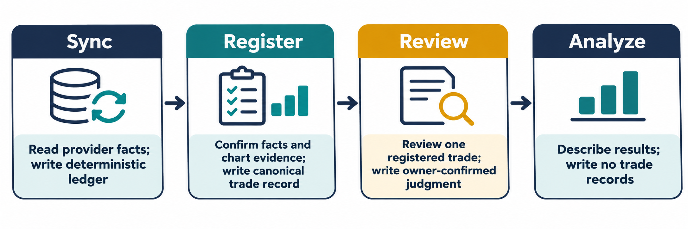
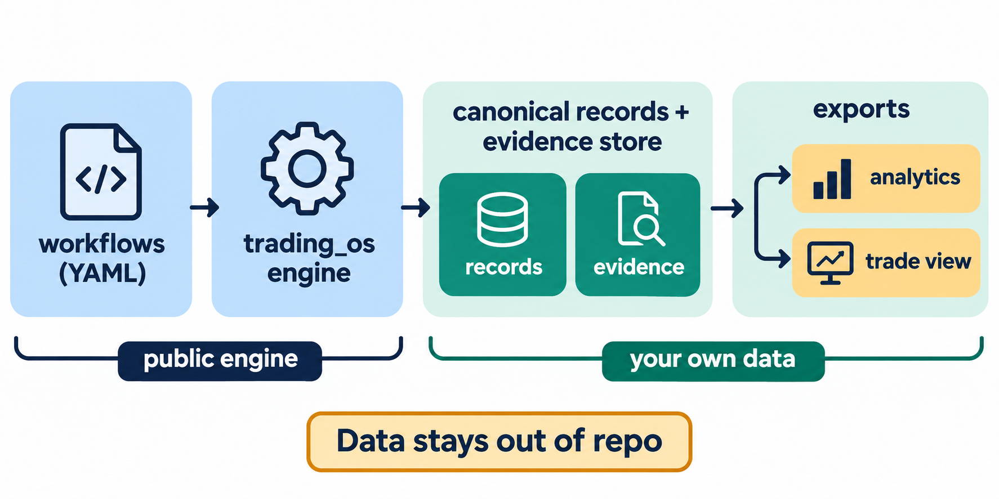
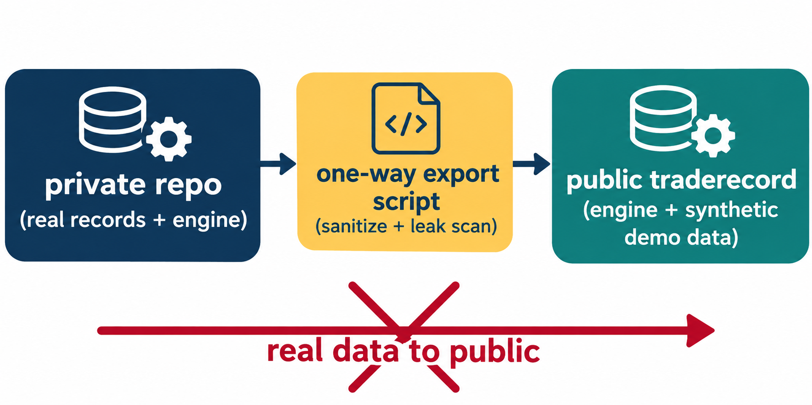

# traderecord

**An evidence-first trading journal engine for humans and AI agents.**

traderecord keeps one durable record of your trades: what happened, why you took
it, the chart evidence, and an independent review afterwards. The design goal is
that nothing in the record can be quietly rewritten, and that an AI agent can help
you maintain it without ever being the authority on what is true.

> **Status: early public release (v0.1).** The engine was extracted from a private
> repository that has run a real trading record for months. This public edition
> ships without any real trade data. It carries a small synthetic baseline
> ([`examples/`](examples/)) so most of the test suite runs; the tests that need the
> maintainer's private records are listed in [`private_only.json`](private_only.json)
> (see [Roadmap](#roadmap)). Expect rough edges
> and open an issue when you hit one.

## What it does

| Operation | Purpose |
|---|---|
| **Sync** | Read-only acquisition of provider/exchange facts into a deterministic ledger. |
| **Register** | Turn a candidate trade into a record, only after the owner confirms the facts, rationale and chart evidence. |
| **Review** | Review one registered trade independently, then save only the owner-confirmed judgment. |
| **Analyze** | Descriptive results and explicitly requested cross-trade diagnosis. |

The four operations are independent: registering never implies reviewing, and
analysis never rewrites records. Each operation is a YAML workflow in
[`workflows/`](workflows/).



## Architecture



## Open-source model



## Design principles

- **Owner-confirmed writes.** An agent proposes; the owner confirms once; a frozen
  registration packet is what actually gets executed.
- **Content-addressed evidence.** Chart images and artifacts are stored by SHA-256
  and referenced by hash, so evidence cannot be swapped silently.
- **Append-only history.** Corrections are new records that supersede old ones.
- **Capability routing, not agent names.** Any agent (or person) that has the
  needed read/write permissions can run a workflow.
- **Pinned strategy versions.** Every trade is bound to the frozen rule version it
  was registered under ([`registry/`](registry/)).

## Quick start

Requires Python 3.10+. Run from a checkout.

```bash
git clone https://github.com/Allen930311/traderecord.git
cd traderecord
pip install pyyaml pytest
python -m pytest             # runs the public test suite
python -m trading_os --help  # list the engine commands
```

The strategies in [`registry/`](registry/) are **synthetic examples**
(`stg-example-a`, `stg-example-b`, and a few well-known public strategy names with
placeholder rules). Replace them with your own strategy definitions.

## Roadmap

- [x] A synthetic baseline (12 invented trades, fake pins) so the register, review and analyze flow and most tests run. Regenerate with `python examples/make_synthetic_baseline.py`.
- [ ] Synthetic equivalents for the 24 test files and 53 single tests still listed in `private_only.json` (they cover the one-time legacy migration and private-adapter paths).
- [ ] Installable package (`pip install traderecord`); today the engine runs from a checkout.
- [ ] More provider adapters (contributions welcome).

## Contributing

Issues and pull requests are welcome. See [CONTRIBUTING.md](CONTRIBUTING.md).
Security reports: [SECURITY.md](SECURITY.md).

## Disclaimer

This is record-keeping software, not financial advice, and not an execution or
signal system. Nothing here recommends any trade.

## License

[Apache-2.0](LICENSE)
